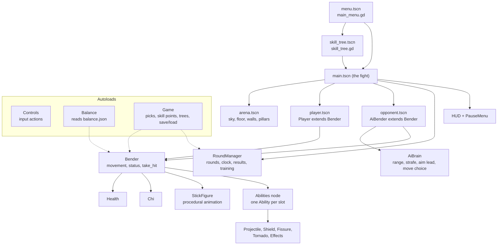

# Bending Arena architecture

Godot 4.4 (GDScript), 3D, no imported assets. Tunable numbers and ability definitions are data in `data/*.json`. Screens are built in code, and the fighters and effects are generated at runtime.

## Overview

## Autoloads (`project.godot`)

| Name | Script | Role |
| --- | --- | --- |
| `Controls` | `scripts/controls.gd` | Registers input actions at startup (WASD, Shift, Space, LMB, RMB, E, F, Q, R, Esc). Input Map entries override them. |
| `Balance` | `scripts/balance.gd` | Loads `data/balance.json`: element stats, every ability's numbers, AI settings. |
| `Game` | `scripts/game.gd` | Chosen element and difficulty, skill points, owned tree nodes, loadouts, match rewards, `save_game()` and `load_game()` to `user://save.json`. |

## Scenes

| Scene | Contents |
| --- | --- |
| `menu.tscn` | Title screen with the arena as a backdrop (`main_menu.gd`). This is the main scene. |
| `skill_tree.tscn` | Skill tree screen (`skill_tree.gd`). |
| `main.tscn` | Arena, spawn markers, Player, HUD, RoundManager and PauseMenu. RoundManager spawns the opponent or the training dummy. |
| `arena.tscn` | Sky, sun, floor (group `floor`), walls, invisible barriers, pillars and backdrop. |
| `player.tscn` | `CharacterBody3D` with Model (StickFigure), Health, Chi, Abilities and CameraPivot > SpringArm3D > Camera3D. |
| `opponent.tscn` | Same body as the player, plus a name tag. |
| `projectile.tscn` | One shot (`Area3D`). |
| `training_dummy.tscn`, `stone_pillar.tscn` | Static target and arena pillar. |

## Core classes

**Bender** (`bender.gd`, extends `CharacterBody3D`) is shared by the player and the AI.
- `apply_element(element, loadout)` builds one ability node per unlocked slot.
- `use_slot(slot)` fires a slot: basic, special, heavy, defense, utility or ultimate.
- `move_with(...)` handles movement with sprint and jump, and applies slows, roots, armor and boosts.
- `take_hit(hit)` applies one hit Dictionary.
- Aim helpers: `muzzle()`, `aim_direction()`, `flat_aim()`, `aim_point()`, `aim_pitch()`.
- Signals: `element_changed`, `loadout_changed`, `hit_taken`.

**Player** (`player.gd`) reads the keyboard and mouse and runs the orbit camera. `aim_direction()` goes from the muzzle to whatever the camera ray hits under the crosshair, so every shot follows the aim up and down.

**AiBender** and **AiBrain** (`ai_bender.gd`, `ai_brain.gd`): the brain thinks every `reaction` seconds. It holds its element's preferred range, strafes, leads its shots at your chest and picks moves in this order: defense, ultimate, special or heavy, then utility. Difficulty sets its reaction time, aim error and unlocked nodes.

**Health** and **Chi** (`health.gd`, `chi.gd`) are components with a `changed` signal; Health also emits `died`. `Chi.spend()` gates every move.

**StickFigure** (`stick_figure.gd`) builds the capsule rig and blends a base pose (stance, run, air, dead) with an action pose each frame. `play(action, pitch)` triggers a pose such as punch, kick, push, sweep, raise, stomp or spin.

**RoundManager** (`round_manager.gd`) runs best-of-3 rounds with a clock, scoring, results, rematch and training mode. Signals: `round_started`, `round_ended`, `match_ended`.

## Abilities (`scripts/abilities/`)

`Ability` (`ability.gd`) is the base. `try_activate()` checks the cooldown and `user.can_act()`, spends chi, starts the cooldown and calls `_activate()`. The `type` field in `balance.json` picks the subclass:

| type | Script | Used by |
| --- | --- | --- |
| projectile | `projectile_ability.gd` | Basic combos, Fireball, Ice Daggers, Ice Prison, Air Cannon, Air Blade, Boulder Barrage, Tidal Wave |
| cone | `cone_ability.gd` | Flame Breath |
| beam | `beam_ability.gd` | Lightning |
| pillar | `pillar_ability.gd` | Earth Column |
| fissure | `fissure_ability.gd` + `fissure.gd` | Fissure |
| wall | `wall_ability.gd` | Ice Wall, Stone Wall |
| shield | `shield_ability.gd` + `shield.gd` | Fire Ring, Air Shield, Rock Armor |
| dash | `dash_ability.gd` | Jet Dash |
| boost | `boost_ability.gd` | Air Scooter |
| heal | `heal_ability.gd` | Healing Water |
| tornado | `tornado_ability.gd` + `tornado.gd` | Tornado |
| area | `area_ability.gd` | No current move; kept for new ones |

Key fields on each ability:
- `combo` turns the basic into a three-hit chain. Keys ending in `_mult` multiply the base value; other keys replace it.
- `look` picks how `projectile.gd` draws the shot (fire_bolt, fireball, water_whip, ice_shard, rock, air_ball, wave and more).
- `anim` picks the stick figure's pose.

## How a hit flows

1. The input or AiBrain calls `Bender.use_slot("special")`.
2. `Ability.try_activate()` passes the checks, then `_activate()` aims with `aim_direction()` (3D) or `flat_aim()` (ground moves).
3. The ability spawns a Projectile, beam, cone check, pillar and so on, and plays the pose and effects.
4. On contact it calls `target.take_hit(hit)` with a Dictionary: `damage, direction, knockback, slow, slow_time, root_time, launch, attacker`.
5. `Bender.take_hit` applies armor, then damage to Health, knockback, launch, slow and root, and flashes the figure.
6. `Health.died` tells RoundManager to end the round. When the match ends, it calls `Game.record_match()`, which awards skill points and saves.

## Data files

- `data/balance.json`: per element `hp`, `move_speed`, `color` and the six `abilities` with their numbers, plus the AI difficulty settings.
- `data/skill_trees.json`: eight nodes per element. Each has `cost`, `tier`, `requires` or `requires_any`, and what it unlocks or modifies. The full tree costs 13 points.

Balance changes need no code; edit the JSON and rerun `--balance`.

## Physics layers

| Layer | Used for |
| --- | --- |
| 1 | World: floor, walls, pillars, walls made by moves |
| 2 | Benders |
| 3 | Targets: training dummy |

Projectiles watch all three. Ground moves ignore the `floor` group.

## Effects

`effects.gd` holds static helpers: particle emitters and bursts, light flashes, element impacts (fire_burst, splash, shatter, debris, dust, gust), and generated meshes (arc crescents, the wave, lightning bolts, spikes, rings). There are no textures or imported models.

## Testing and builds

- `tests/smoke_test.gd` runs an automated playthrough: `godot --headless --fixed-fps 60 --path . -- --smoke`. Flags: `--quick` plays one match, `--balance` plays every element against every other, and `--shots=<dir>` saves screenshots.
- `export_presets.cfg` has two presets. "Windows Desktop" is a single x86_64 exe with the game files embedded. "macOS" is a universal `.app` in a zip, ad-hoc signed and not notarized.
